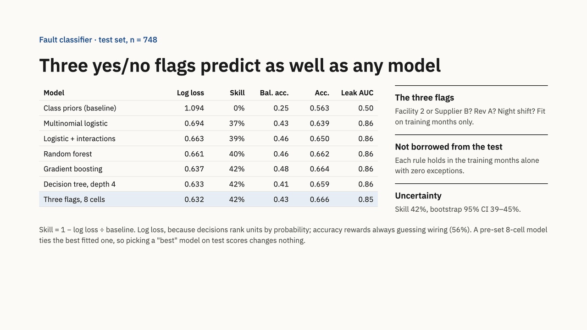

# AirBenders: Airedale field failure analysis

Our entry for the Airedale Applied Intelligence Challenge, Data Science track. We took one year of field service, rework and end-of-line test (EOLT) records for 3,000 failed units, worked out which build conditions go with which fault, predicted fault and repair cost at shipment on months the models never saw, and used those predictions to choose investments within a $750K budget.



## What we found

- **Each specific fault shows up under one build condition.** Leaks only on units built at Facility 2 or with Supplier B coils (0 of 1,570 failures elsewhere). Controls faults only on controls revision A. Fan rotation faults only on night shift. Power wiring, the most common fault, has no build driver.
- **Three yes/no flags predict the fault as well as any model we fit.** On the held-out months, an 8-cell model built from those three conditions scores a log loss of 0.632, tying a tuned decision tree (0.633) and cutting log loss 42% against base rates (95% CI 39 to 45%).
- **Leaks are 26% of failures but 76% of field cost.** A leak averages $3,670 to repair; a wiring fault, $264.
- **Every field leak had already been caught at EOLT**, repaired, and passed retest. That points at repair quality more than missing detection.
- **Recommendation:** commit $100K to Smart Torque Tools now (it is in 98% of simulated winning portfolios) and release the other $625K after two short pilots. The best portfolio at catalog values returns about $4.6M net over three years.

The full write-up, with every number and its source file, is in [FINDINGS.md](FINDINGS.md).

## The deck

[deck/AirBenders_deck.pdf](deck/AirBenders_deck.pdf) has all 17 slides: 14 for the 7-minute talk and 3 backup slides for Q&A.

## Run it

You need Python 3.10 or later.

```bash
pip install -r requirements.txt
./run_all.sh
```

This rebuilds every table, figure and number from the four raw files in `data/` in about five minutes. Outputs go to `out/` and charts to `figs/`.

| Step | Script | What it does | Main output |
|---|---|---|---|
| 1 | `01_clean.py` | Joins the four files on serial number, reconciles the three defect labels by 2-of-3 vote | `out/clean.csv` |
| 2 | `02_inference.py` | Fisher exact tests with Wilson CIs, log-cost regression with bootstrap CIs | `out/02_inference_report.txt` |
| 3 | `03_models.py` | Fault classifiers and cost regressions on a time split, clustering of build cells | `out/03_models_report.txt` |
| 4 | `04_portfolio.py` | Scores all 178 portfolios under $750K, scenarios, Monte Carlo, failures avoided | `out/04_portfolio_report.txt` |
| 5 | `05_figs.py` | Charts | `figs/` |
| 6 | `06_rule_check.py` | Three-flag rule model, bootstrap CIs, calibration | `out/06_rule_check_report.txt` |

## Repo layout

```
data/      the four raw datasets (D1 field, D3 config, D4 rework, D5 EOLT)
out/       reports and CSVs every number in the deck comes from
figs/      charts made by 05_figs.py
deck/      the final slide deck as a PDF
FINDINGS.md  full method, results, assumptions and limitations
```

## Limits worth knowing

Every unit in the data failed, so we model which fault a failed unit has and what it costs, not whether a unit fails. The warranty file wasn't provided, so field repair cost stands in for warranty cost. Results are associations from observational data, not proven causes; FINDINGS.md lists how we'd confirm each one.

## Team

Devin, Prateek, Sajjad, Rishik and Arrush.
